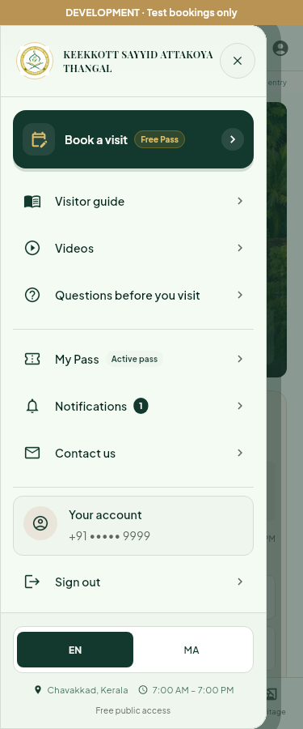
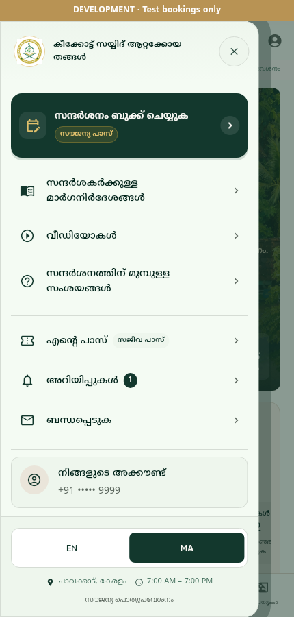
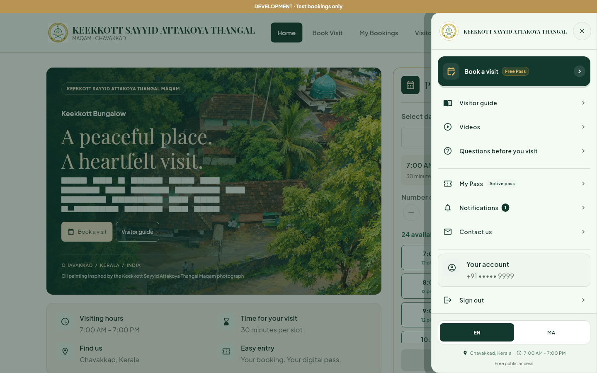

# Sanctuary navigation review

The shared navigation drawer now follows the supplied Stitch HTML on mobile and desktop: pale green surfaces, the official crest, a forest-green booking card with a brass Free Pass badge, grouped icon links, fine dividers, and a language/footer panel. The app-bar menu buttons share the same styling. EN / MA is used throughout the header and drawer.

English navigation shows English labels without Malayalam subtitles. Malayalam mode translates the main labels instead of stacking two languages. Existing English location labels remain in the app bar; supplementary header text is omitted in Malayalam and in the compact keyboard header. Large text can wrap, and the drawer footer joins the scrollable links on short screens or with enlarged text.

The desktop drawer still opens from the right and the mobile drawer from the left. Existing routes, staff permissions, account information, pass retrieval, and sign-out remain connected. Active-pass and unread-notification badges appear only when supplied by the existing repositories. Visiting hours come from the current configuration and availability, including closed/loading/error states. The sample's notification count, active-pass status, opening hours, and trust attribution are not hardcoded.

## Reference limitation

The uploaded `stitch_keekkott_bungalow_visitor_portal (2).zip` contains `code.html` and `screen.png`. The PNG is a 28-byte error message (`<FIFE Image failed to fetch>`), and there is no `DESIGN.md`. The complete HTML is the visual reference. Its simulated Safari and iOS controls are browser/device chrome, so they are not added to the app.

## Rendered previews

These are actual Flutter renders with bundled fonts and isolated test repositories. The development banner identifies test data; no real bookings, SMS, or notifications were created. Widget tests use a fallback for external media. In the desktop screenshot, unstyled rich text behind the drawer scrim may show the test runner's placeholder glyphs; the navigation typography renders from the bundled fonts.

| Mobile · English · 375px | Mobile · Malayalam · 430px |
| --- | --- |
|  |  |



## Verification

- Analyzer and release web build with the development configuration.
- Full Flutter suite, including booking/authentication, staff routes, and navigation.
- New drawer checks cover 320, 375, 430, 768, 1440, and 1920px; 200% Malayalam text; short viewports; close/reopen; guest, visitor, admin, and Khadim visibility; real-data badges; language switching without losing a booking draft; and sign-out with successful or failed notification cleanup.
- Existing localization tests exercise drawer section shortcuts on mobile, tablet, and desktop. OTP/keyboard checks cover both languages at 320 × 640px with 200% text.

To regenerate the focused navigation previews:

```sh
CI=true flutter test --no-pub test/navigation_drawer_test.dart --dart-define=CAPTURE_QA=true
```

Captures are generated in `build/qa/navigation_*.png`.
